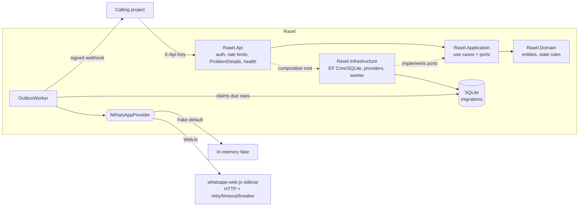

# Rasel

A standalone, reusable WhatsApp messaging and OTP gateway. Other projects integrate with it over REST using an API key.

> **WhatsApp is FAKE by default.** `WhatsApp:Provider=Fake` keeps everything in memory: no real message is ever sent. A fake session shows a fake QR and becomes `Connected` the first time its QR is fetched. A real provider (`WebJs`, an HTTP client for a whatsapp-web.js sidecar) is implemented and tested against stubs, but has **not** been run against a real sidecar.

## Architecture



Dependency rule: `Domain <- Application <- Infrastructure`, `Api` composes both. Details and decisions: [docs/ARCHITECTURE.md](docs/ARCHITECTURE.md). OTP threat model: [docs/SECURITY.md](docs/SECURITY.md). Audit of the original prototype: [docs/AUDIT.md](docs/AUDIT.md).

## Run

```bash
dotnet run --project src/Rasel.Api      # http://localhost:5114, Swagger UI at /swagger (Development only)
```

* On first start the schema is created by the committed EF Core migrations and a `dev` client is seeded. In **Development** a random API key is logged once; set `Seed__DevApiKey` to choose your own (the only way to get a known key outside Development).
* A database created by the old prototype (`EnsureCreated`, no migration history) is not upgradable: delete `rasel.db` once.
* Outside Development the app **refuses to start** while secrets are the committed `dev-only` placeholders or shorter than 32 characters.
* Production example:

```bash
ASPNETCORE_ENVIRONMENT=Production \
Security__OtpPepper="$(openssl rand -hex 32)" Security__TokenSecret="$(openssl rand -hex 32)" \
Seed__DevApiKey="$(openssl rand -hex 24)" Database__Path=/var/lib/rasel/rasel.db \
dotnet run --project src/Rasel.Api
```

Terminate TLS in front of Rasel (reverse proxy). Rasel does not read `X-Forwarded-For`, so per-IP throttling sees the proxy address unless forwarded headers are configured.

## Configuration

Every setting lives in `src/Rasel.Api/appsettings.json` and can be overridden with environment variables (`Section__Key`). All sections are validated at startup; an invalid value stops the host before it serves traffic.

| Key | Default | Meaning |
|---|---|---|
| `Database:Path` | `rasel.db` | SQLite file |
| `Database:MigrateOnStartup` | `true` | Apply migrations at startup; if `false`, startup fails when migrations are pending |
| `Security:OtpPepper` | dev placeholder | HMAC key for OTP hashes, >= 32 chars, never `dev-only` outside Development |
| `Security:TokenSecret` | dev placeholder | HS256 key for the verification token, same rules, must differ from the pepper |
| `Seed:DevApiKey` / `Seed:DevDailyMessageLimit` | empty / 1000 | Seeds the `dev` client when the database has no client |
| `Api:RequestsPerMinute` | 600 | Per API key quota (429 `rate_limited`) |
| `Api:FailedAuthPerMinute` | 20 | Wrong-key attempts per client IP before it is throttled (429 `auth_throttled`) |
| `Api:MaxKeyLength` | 128 | Longer keys are rejected without a lookup |
| `Api:MaxRequestBodyBytes` | 65536 | Kestrel body limit (413) |
| `Api:ShutdownTimeoutSeconds` | 30 | Graceful shutdown window |
| `Otp:TtlSeconds` | 300 | Code lifetime |
| `Otp:MaxAttempts` | 5 | Wrong guesses before the challenge locks |
| `Otp:CodeLength` | 6 | Digits (4-9) |
| `Otp:ResendCooldownSeconds` | 60 | Minimum gap between codes for one phone/purpose |
| `Otp:PerPhonePerHour` / `Otp:PerClientPerMinute` | 5 / 60 | Code request limits |
| `Outbox:PollIntervalMs` | 500 | Idle poll interval of the worker |
| `Outbox:MinDelayMs` / `Outbox:MaxDelayMs` | 1000 / 3000 | Random pause between sends (anti-robot) |
| `Outbox:MaxAttempts` | 5 | Attempts before a transient failure becomes `Failed` |
| `Outbox:BaseBackoffSeconds` / `Outbox:MaxBackoffSeconds` | 5 / 900 | Exponential retry backoff |
| `Outbox:LeaseSeconds` / `Outbox:BatchSize` | 120 / 10 | Claim lease (crash recovery) and batch size |
| `WhatsApp:Provider` | `Fake` | `Fake` or `WebJs` |
| `WhatsApp:WebJs:BaseUrl` / `ApiToken` | empty | Sidecar address and bearer token (required for `WebJs`) |
| `WhatsApp:WebJs:AttemptTimeoutSeconds` | 10 | Per-attempt HTTP timeout |
| `WhatsApp:WebJs:ReadRetries` | 2 | Retries for GET/DELETE only (sends are never retried at HTTP level) |
| `WhatsApp:WebJs:Breaker*` | 5 / 0.5 / 30 s / 30 s | Circuit breaker: min throughput, failure ratio, sampling, break duration |
| `Webhooks:Enabled` / `Url` / `Secret` | false / empty / dev placeholder | Signed `message.sent` / `message.failed` events (https outside Development) |

## API

All `/v1` endpoints need `X-Api-Key`. Errors are RFC 7807 `application/problem+json` with a stable `code` and a `traceId`. Versioned responses carry `X-Api-Version: v1`.

```bash
KEY=...   # your API key
H="X-Api-Key: $KEY"; J="Content-Type: application/json"; B=http://localhost:5114

curl $B/health/live                                                    # liveness
curl $B/health/ready                                                   # database + outbox (unhealthy check -> 503; DB-down path not exercised by tests)

curl -H "$H" -H "$J" -d '{"name":"main"}' $B/v1/sessions               # 201 {id, name, status}
curl -H "$H" $B/v1/sessions/{id}/qr                                    # fake QR; session becomes Connected
curl -H "$H" $B/v1/sessions/{id}                                       # status
curl -H "$H" -X DELETE $B/v1/sessions/{id}                             # 204

# send: 202 Queued; the outbox delivers it, retrying transient failures with backoff
curl -H "$H" -H "$J" -H "Idempotency-Key: order-42" \
     -d '{"phone":"+201001234567","text":"hello"}' $B/v1/messages
# same key + same body  -> 202 with the original messageId and header Idempotent-Replayed: true
# same key + other body -> 409 idempotency_key_reused
curl -H "$H" -H "$J" -d '{"groupName":"Rasel Demo Group","text":"hello team"}' $B/v1/messages

curl -H "$H" -H "$J" -d '{"phone":"+201001234567","purpose":"login","channel":"whatsapp"}' $B/v1/otp/request
# -> {challengeId, expiresInSeconds, resendAfterSeconds}   (the code is never returned)
curl -H "$H" -H "$J" -d '{"challengeId":"...","code":"123456"}' $B/v1/otp/verify
# -> {token, expiresInSeconds}   token = HS256 JWT (iss, aud, jti, clientId, phone, purpose), 5 min
```

| Status | `code` examples |
|---|---|
| 400 | `invalid_phone`, `invalid_text`, `invalid_target`, `invalid_code_format`, `otp_invalid`, `invalid_request` |
| 401 / 429 | `unauthorized`, `auth_throttled`, `rate_limited`, `otp_resend_too_soon`, `otp_rate_limited`, `daily_limit_reached` |
| 404 / 409 / 410 / 423 | `session_not_found`, `group_not_found`; `group_ambiguous`, `otp_already_used`, `idempotency_key_reused`; `otp_expired`, `otp_superseded`; `otp_locked` |
| 502 | `otp_delivery_failed`, `provider_unavailable` |

Groups are addressed by **exact name**: zero matches is 404, more than one is 409.

### Webhooks

`POST` with JSON `{event, clientId, timestamp, data}` and headers `X-Rasel-Timestamp` (unix seconds) and `X-Rasel-Signature: sha256=<hex>`, where the signature is `HMAC-SHA256(secret, "<timestamp>.<raw body>")`. Receivers should reject timestamps older than a few minutes. Events fire once per message, on the final outcome only. Webhook delivery is best effort (no retry yet).

## Tests

```bash
dotnet build -warnaserror
dotnet test            # Domain, Application (in-memory), Infrastructure (real SQLite, concurrency), Api (in-process HTTP)
```

Adding a migration: `dotnet ef migrations add <Name> -p src/Rasel.Infrastructure -s src/Rasel.Infrastructure -o Persistence/Migrations`. A test fails if the model and the migrations drift apart.
