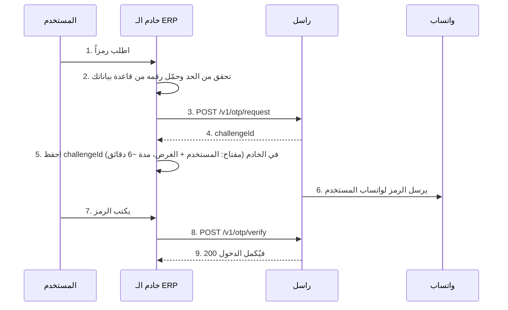

# دمج راسل في مشروعك

كيف يضيف أي تطبيق رسائل واتساب ورموز التحقق عبر راسل. المرجع الكامل: [API.md](API.md) (إنجليزي) وملخصه [API.ar.md](API.ar.md). النسخة الإنجليزية الكاملة بالأمثلة: [INTEGRATION.md](INTEGRATION.md).

**ما الذي نُفِّذ فعلاً؟** عميل .NET وعميل TypeScript وسكربت PowerShell وأوامر curl في [examples/](examples/) **شُغِّلت كلها على راسل محلي بالمزوّد التجريبي (Fake)** بمفتاح تجريبي محلي، والمخرجات المعروضة في النسخة الإنجليزية حقيقية. لم يُرسَل شيء عبر واتساب حقيقي، لذلك لم يُجرَّب التسليم الحقيقي ولا نجاح التحقق من رمز حقيقي. قسم أفزاز (ERP) تصميم مقترح، ولم يُقرأ أو يُعدَّل أي مستودع من أفزاز.

## قائمة مراجعة سريعة

1. راسل يعمل وجلسة **متصلة** (انظر [دليل الاستخدام](USER-GUIDE.ar.md)).
2. مفتاح الخدمة محفوظ في مخزن الأسرار، **لا في الكود**.
3. **خادمك الخلفي** هو من يتصل براسل. المتصفح وتطبيق الجوال يتصلان بخادمك فقط.
4. كل إرسال يحمل `Idempotency-Key` يصف الحدث (مثل `order-42-shipped`).
5. تتعامل مع الرد `202` ثم تتابع الحالة بالاستعلام أو بـ webhook، وتعالج أكواد الأخطاء.

## المفتاح: الحصول عليه وتدويره

* لا يوجد مسار في راسل لإنشاء المفاتيح أو تدويرها. أول تشغيل بقاعدة فارغة يزرع عميلاً واحداً (`dev`) مفتاحه من `Seed__DevApiKey` (16 حرفاً فأكثر خارج التطوير) أو مفتاح عشوائي يُطبع مرة واحدة في وضع التطوير فقط.
* عامل المفتاح ككلمة سر: طويل وعشوائي، ويُفضَّل مفتاح لكل تطبيق.
* يُخزَّن خادمياً تجزئة SHA-256 فقط، والمفتاح المفقود لا يُسترجع.
* **التدوير** (تصميم لم يُنفَّذ): أضف سطر عميل ثانٍ في جدول `ApiClients` بتجزئة SHA-256 (حروف كبيرة hex) للمفتاح الجديد، انشره في تطبيقك، تأكد من عمله، ثم عطّل القديم (`Active = 0`). يعمل المفتاحان أثناء التداخل فلا توقف. تحقق من أسماء الأعمدة في قاعدتك قبل أي SQL.
* عند تسرّب مفتاح: عطّل سطره فوراً.

## الإعداد

احتفظ بقيمتين لكل بيئة خارج مستودع الكود: `Rasel__BaseUrl` و`Rasel__ApiKey` (متغيرات بيئة أو user-secrets أو Key Vault أو أسرار Docker). ضع راسل خلف TLS خارج الشبكة الخاصة.

## البنية الموصى بها

* **من الخادم فقط.** من يحصل على المفتاح يستطيع الإرسال لأي رقم حتى حدك اليومي، فلا تضعه في متصفح أو تطبيق جوال. اعرض نقطة ضيقة في خادمك («أرسل لي رمز الدخول») واتصل براسل منها.
* **أعد المحاولة بأمان:** أعد فقط أخطاء الشبكة و5xx وبشرط وجود `Idempotency-Key` (أو GET). التكرار يعيد نفس `messageId` مع `replayed: true`. لا تعد المحاولة مع 4xx (مثل 429/423/400) فهي قرارات لا أعطال.
* **لا تثق بالمتصفح في رقم الهاتف عند التحقق**: احفظ الرقم والغرض في الخادم.
* ضع حدّ معدّل خاصاً بك (لكل مستخدم وعنوان) أمام راسل.

## الإرسال غير المتزامن

`POST /v1/messages` يرد `202 Queued`: الرسالة مقبولة لا مُرسَلة بعد. تابع النتيجة بأحد أمرين:

* **الاستعلام**: `GET /v1/messages/{id}` حتى تصبح الحالة `Sent` أو `Failed` (مرة كل ثانية لبضع ثوانٍ تكفي؛ في التجربة المحلية صارت `Sent` بعد نحو 1.5 ثانية).
* **Webhook** (اختياري): `message.sent` / `message.failed` مرة واحدة بتوقيع `X-Rasel-Signature`، والتحقق في [examples/verify-webhook.ts](examples/verify-webhook.ts). المحاولة واحدة فقط فاحتفظ بالاستعلام كاحتياط.

## الأمثلة (في examples/)

| الملف | الوصف | شُغِّل؟ |
|---|---|---|
| `RaselClient.cs` | عميل .NET بنوعيات + إعادة محاولة بسيطة + تسجيل DI + مساعدات OTP | نعم، على Fake |
| `rasel-client.ts` | عميل TypeScript للخادم (Node 18+) | نعم، على Fake |
| `rasel.ps1` | PowerShell | نعم، على Fake |
| `verify-webhook.ts` | التحقق من توقيع webhook | نعم (اختبار ذاتي + مطابقة مع HMAC في .NET) |

أمثلة curl في [INTEGRATION.md](INTEGRATION.md#curl). تطبيق Angular لا يتصل براسل أبداً؛ يتصل بخادمك الذي يستخدم أحد العملاء أعلاه.

## دمج راسل في نظام ERP مثل أفزاز

مثال تصميمي (لم يُقرأ ولم يُعدَّل أي مستودع من أفزاز، ولم يُنفَّذ المسار كاملاً):

**أين يُحفظ challengeId؟** في خادم الـ ERP مربوطاً بجلسة المستخدم قبل الدخول (ذاكرة مؤقتة أو جدول صغير بمدة أطول قليلاً من 300 ثانية)، بمفتاح المستخدم والغرض. لا تقبل رقماً أو challengeId من المتصفح عند التحقق، وامسحه بعد النجاح أو القفل.

| عند الطلب | التصرف |
|---|---|
| 200 | احفظ `challengeId` وابدأ عدّاً تنازلياً 60 ثانية |
| 429 `otp_resend_too_soon` | ليس خطأ للمستخدم: اعرض العدّ التنازلي من `Retry-After` |
| 429 `otp_rate_limited` / `recipient_daily_limit` / `daily_limit_reached` | اطلب المحاولة لاحقاً وأبلغ التشغيل |
| 409 `session_not_connected` / 404 `session_not_found` / 502 | مشكلة تشغيلية: «الخدمة غير متاحة مؤقتاً» دون تفاصيل، وأبلغ التشغيل |

| عند التحقق | التصرف |
|---|---|
| 200 | أكمل الدخول وامسح الـ challenge |
| 400 `otp_invalid` | الرمز خاطئ، اسمح بحتى 5 محاولات |
| 423 `otp_locked` | توقف وامسح الـ challenge؛ على المستخدم طلب رمز جديد بعد المهلة |
| 410 `otp_expired` / `otp_superseded` | اعرض «أرسل رمزاً جديداً» |
| 409 `otp_already_used` | اعتبره فشلاً واطلب رمزاً جديداً |
| 400 `invalid_code_format` | تحقق أن الرمز 6 أرقام في الواجهة قبل الإرسال |

كود ASP.NET التوضيحي لنقطتي `/api/otp/request` و`/api/otp/verify` في [INTEGRATION.md](INTEGRATION.md#7-integrating-with-an-erp-like-afzaz) (توضيحي، لم يُشغَّل).

