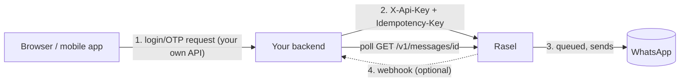
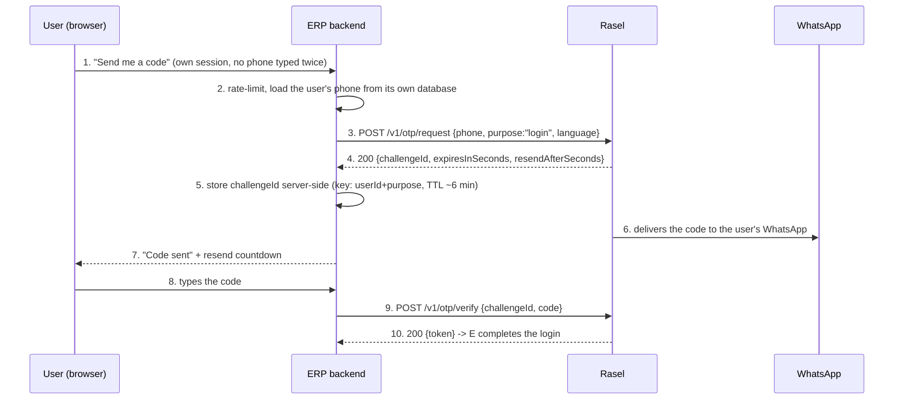

# Integrating Rasel into your project

How any application adds WhatsApp messages and OTP through Rasel. Complete reference: [API.md](API.md). Arabic: [INTEGRATION.ar.md](INTEGRATION.ar.md). Admin console guide: [USER-GUIDE.en.md](USER-GUIDE.en.md).

**What was run for this guide.** The .NET client, the TypeScript client, the PowerShell script and curl commands were all **executed against a local Rasel (Fake provider, port 5114, a throwaway local key)** and the outputs shown are real. Nothing was sent through real WhatsApp, so real delivery and the successful OTP verification (needs the real code) were **not** exercised. The Afzaz section is a design example; no Afzaz repository was read or modified.

## Table of contents

1. [Checklist](#1-checklist)
2. [API key: obtaining and rotating](#2-api-key-obtaining-and-rotating)
3. [Configuration](#3-configuration)
4. [Recommended architecture](#4-recommended-architecture)
5. [Sending, async results, webhooks](#5-sending-async-results-webhooks)
6. [Client examples](#6-client-examples)
7. [Integrating with an ERP like Afzaz](#7-integrating-with-an-erp-like-afzaz)

## 1. Checklist

1. Rasel running and **Connected** session linked (admin console, [guide](USER-GUIDE.en.md)).
2. An API key stored in your secret store.
3. Your **backend** calls Rasel; browsers and mobile apps call your backend.
4. Every send carries an `Idempotency-Key`.
5. You handle `202` + polling (or webhooks) and the error codes in [API.md](API.md#7-error-codes).

## 2. API key: obtaining and rotating

* Rasel has **no endpoint** to create, list or rotate keys. The first start with an empty database seeds one client (`dev`): its key is `Seed__DevApiKey` if you set it (16+ characters outside Development), otherwise a random one that is logged once in Development only.
* Treat the key like a password: long, random (`openssl rand -hex 24`), one per consuming application ideally.
* Only a SHA-256 hash is stored server side; a lost key cannot be recovered.
* **Rotation** (design, not executed): add a second client row in the `ApiClients` table with the new key's uppercase hex SHA-256 hash and the same daily limit, deploy the new key to your application, confirm traffic, then set the old row `Active = 0`. Because both keys work during the overlap, rotation needs no downtime. Verify the column names against your database before running SQL.
* If a key leaks: deactivate its row immediately; messages already queued still send.

## 3. Configuration

Keep two values per environment, **outside source control** (environment variables, user-secrets, Key Vault, Docker/Kubernetes secrets):

| Name | Example |
|---|---|
| `Rasel__BaseUrl` | `https://rasel.internal.example.com` |
| `Rasel__ApiKey` | (from the secret store) |

Put Rasel behind TLS (reverse proxy) outside a private network; the key travels in a header.

## 4. Recommended architecture



* **Backend only.** The key authorizes sending to any number up to your daily limit; if it ships in a browser or mobile bundle anyone can extract it. Expose your own narrow endpoint ("send me a login code") and call Rasel from it.
* **Retry safely.** Retry network errors and 5xx only when the request has an `Idempotency-Key` (or is a GET). A repeat returns the same `messageId` with `replayed: true`. Do not retry 4xx: they are decisions (429/423/400).
* **Never trust the browser for the phone number at verify time.** Remember which phone and purpose you asked for, server side.
* **Rate-limit your own endpoint** (per user and per IP) in front of Rasel; Rasel's limits protect Rasel, yours protect your users.

## 5. Sending, async results, webhooks

`POST /v1/messages` answers **`202 Queued`**: the message is accepted, not sent. Choose how to learn the result:

* **Polling**: `GET /v1/messages/{id}` until `status` is `Sent` or `Failed` (once per second for a few seconds is plenty; the client examples include `WaitForFinalStatusAsync`). In a local run the message became `Sent` about 1.5 s after queuing.
* **Webhooks** (optional): `message.sent` / `message.failed` once, signed with `X-Rasel-Signature`. Verify with [examples/verify-webhook.ts](examples/verify-webhook.ts) (algorithm in [API.md](API.md#9-webhooks)). Delivery is one attempt, so keep a polling fallback.

Choose idempotency keys that describe the business event, not random per attempt: `order-42-shipped`, `invoice-2026-0017-reminder`. The same key with different content returns `409 idempotency_key_reused`.

## 6. Client examples

All in [examples/](examples/). Each was run against the local API.

### .NET: `RaselClient.cs`

Typed client over `HttpClient` with simple exponential-backoff retry, DI registration, OTP helpers.

```csharp
// Program.cs / Startup
builder.Services.AddRasel(o =>
{
    o.BaseUrl = builder.Configuration["Rasel:BaseUrl"]!;
    o.ApiKey  = builder.Configuration["Rasel:ApiKey"]!;   // from the secret store
});

// anywhere
var m  = await rasel.SendTextAsync("+20XXXXXXXXXX", "Your order shipped", "order-42-shipped");
var st = await rasel.WaitForFinalStatusAsync(m.MessageId, TimeSpan.FromSeconds(30));
```

Real run output:

```
session 31cac4e0-2199-40df-a453-341164f6b9f2 NeedsQr
status Connected
send 2dd8fad4-1d93-4f7a-986c-ff8f1687bde3 Queued replayed=False
replay replayed=True same=True
final Sent attempts=1
otp c6d293af-389f-4084-b2fe-c426fbf75673 ttl=300 resend=60
again -> 429 otp_resend_too_soon retryAfter=60
verify -> 400 otp_invalid: 400 otp_invalid: Incorrect code. 4 attempt(s) left.
```

(The session was `NeedsQr` at creation and `Connected` after the Fake QR fetch, exactly as the Fake provider is designed.)

### TypeScript: `rasel-client.ts` (server side, Node 18+)

Same shape, uses the built-in `fetch`. Run: `RASEL_URL=... RASEL_KEY=... node --experimental-strip-types rasel-client.ts` (Node 22.6+). Real output ended with:

```
again -> 429 otp_resend_too_soon retryAfter 60
verify -> 400 otp_invalid 400 otp_invalid: Incorrect code. 4 attempt(s) left.
```

An Angular app must not call Rasel. It calls **your** backend, which wraps the client above. An Angular service for that proxy scenario (illustrative, **not run**; it talks to your own `/api/otp` endpoints):

```ts
@Injectable({ providedIn: 'root' })
export class OtpApi {
  private http = inject(HttpClient);
  request(phone: string) { return this.http.post<{ resendAfterSeconds: number }>('/api/otp/request', { phone }); }
  verify(code: string)   { return this.http.post<{ ok: boolean }>('/api/otp/verify', { code }); }
}
```

### curl

```bash
KEY=...; B=http://localhost:5114
curl -H "X-Api-Key: $KEY" -H "Content-Type: application/json" -H "Idempotency-Key: order-42-shipped" \
     -d '{"phone":"+20XXXXXXXXXX","text":"Your order shipped"}' $B/v1/messages
curl -H "X-Api-Key: $KEY" $B/v1/messages/<messageId>
```

### PowerShell: `rasel.ps1`

`$env:RASEL_KEY='...'; .\rasel.ps1`. Real output:

```
{"id":"de0cfdd4-...","status":"Sent","attempts":1,"createdAt":"...","sentAt":"...","nextAttemptAt":null,"lastErrorCode":null}
otp challenge 322230be-326e-4d18-ab1d-48f689f74492
-> HTTP 429 code=otp_resend_too_soon
-> HTTP 400 code=otp_invalid
```

## 7. Integrating with an ERP like Afzaz

A worked example for a typical ERP (customers log in or confirm an action with a code). It is a **design**; no Afzaz repository was read or changed, and the flow was not executed end to end.



**Where to store the challenge id.** On the ERP server, tied to the user's pre-login session (cache or a small table with a TTL slightly above `expiresInSeconds`, 300 s), keyed by user and purpose. Do not accept a phone number or challenge id from the browser at verify time; look them up. Delete it after success or lock.

**What to do on each outcome** (codes from [API.md](API.md#7-error-codes)):

| Result at request | Do |
|---|---|
| 200 | Store `challengeId`; start a countdown from `resendAfterSeconds` (60). |
| 429 `otp_resend_too_soon` | Not an error for the user: show the countdown using `Retry-After`. |
| 429 `otp_rate_limited` / `recipient_daily_limit` / `daily_limit_reached` | Tell the user to try later; alert operations on the last two (limit configuration). |
| 409 `session_not_connected`, 404 `session_not_found`, 502 | Operational problem: show "service temporarily unavailable", alert operations. Do not leak details. |

| Result at verify | Do |
|---|---|
| 200 | Accept and complete login; discard the challenge. |
| 400 `otp_invalid` | Say the code is wrong; the `detail` text says attempts left (do not parse it; just allow up to 5 tries). |
| 423 `otp_locked` | Stop. Clear the stored challenge; the user must request a new code (after the cooldown). |
| 410 `otp_expired` / `otp_superseded` | Offer "send a new code". |
| 409 `otp_already_used` | Treat as failure; request a new code. |
| 400 `invalid_code_format` | Validate 6 digits in the UI before calling. |

**Minimal ERP endpoints** (ASP.NET, using the client above; illustrative, **not run**):

```csharp
app.MapPost("/api/otp/request", async (HttpContext ctx, RaselClient rasel, IOtpStore store, IUserPhones phones) =>
{
    var user = ctx.UserId();                              // from your pre-login session
    var phone = await phones.GetAsync(user);              // from YOUR database, not from the browser
    try
    {
        var c = await rasel.RequestOtpAsync(phone, "login", "ar");
        await store.SaveAsync(user, "login", c.ChallengeId, TimeSpan.FromMinutes(6));
        return Results.Ok(new { resendAfterSeconds = c.ResendAfterSeconds });
    }
    catch (RaselException e) when (e.Code == "otp_resend_too_soon") { return Results.Json(new { resendAfterSeconds = e.RetryAfterSeconds }, statusCode: 429); }
    catch (RaselException) { return Results.Json(new { message = "try later" }, statusCode: 503); }
});

app.MapPost("/api/otp/verify", async (HttpContext ctx, VerifyDto dto, RaselClient rasel, IOtpStore store) =>
{
    var user = ctx.UserId();
    if (await store.GetAsync(user, "login") is not Guid id) return Results.BadRequest();
    try { await rasel.VerifyOtpAsync(id, dto.Code); await store.DeleteAsync(user, "login"); return Results.Ok(new { ok = true }); }
    catch (RaselException e) when (e.Code == "otp_invalid") { return Results.Json(new { ok = false }, statusCode: 400); }
    catch (RaselException e) when (e.Code is "otp_locked" or "otp_expired" or "otp_superseded" or "otp_already_used")
    { await store.DeleteAsync(user, "login"); return Results.Json(new { ok = false, retryWithNewCode = true }, statusCode: 400); }
});
```

For non-OTP notifications (invoice ready, delivery update) use `SendTextAsync` with a key per business event, and poll or use the webhook to record the final state next to the invoice. Remember the number is a dedicated number with daily limits: send only expected messages ([guide, section 7](USER-GUIDE.en.md)).
