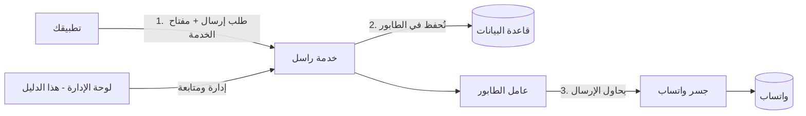
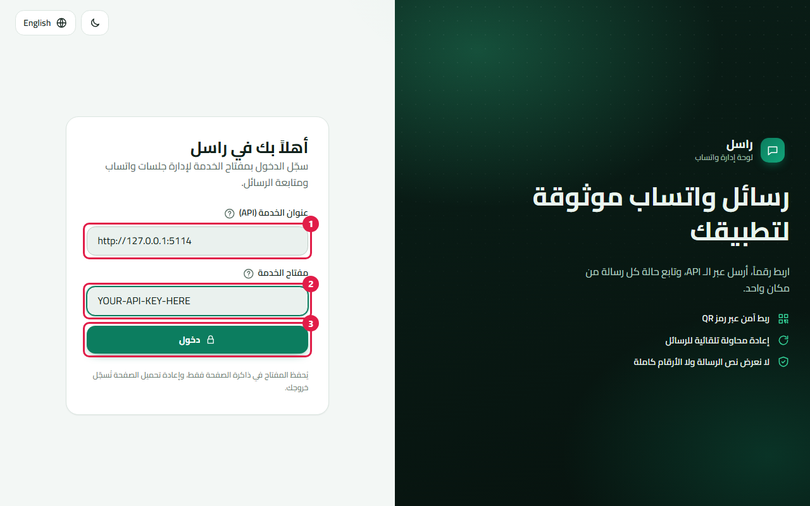
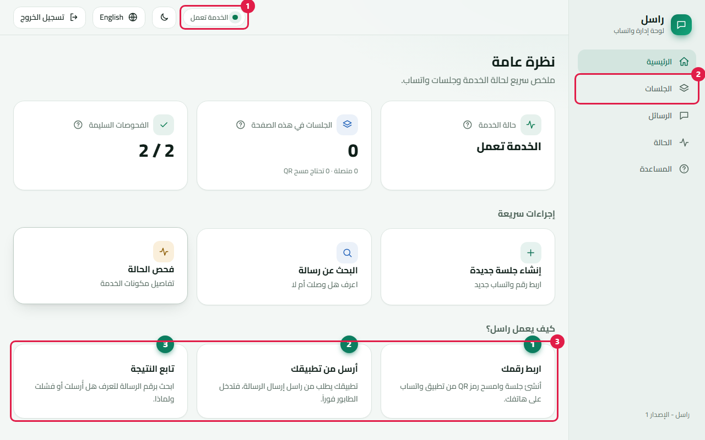
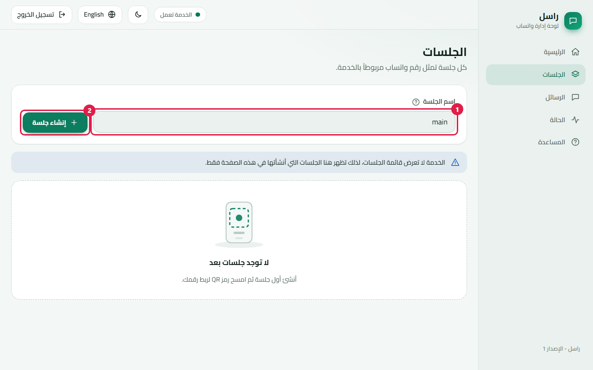
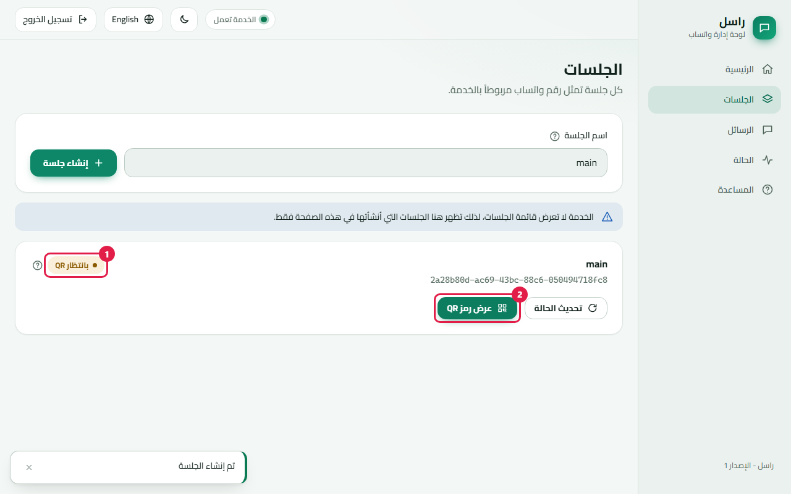
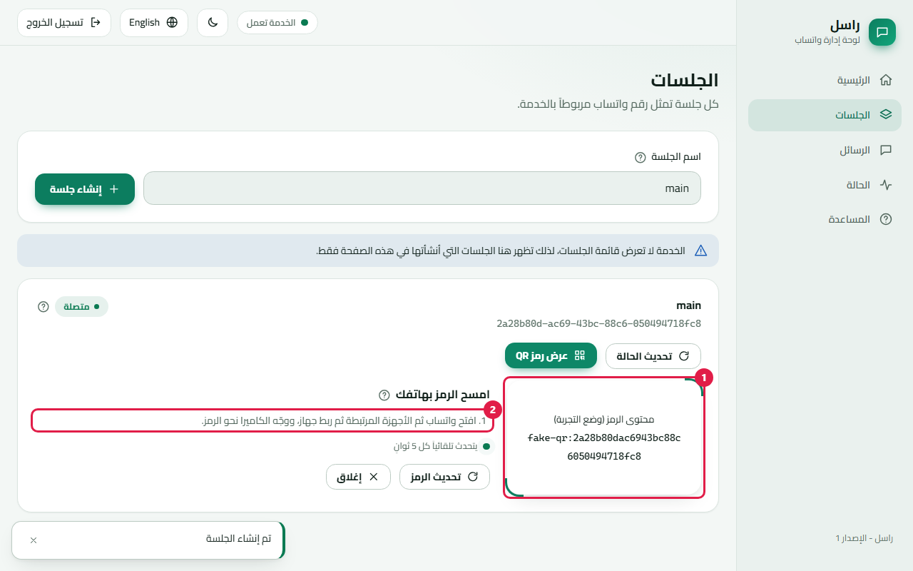
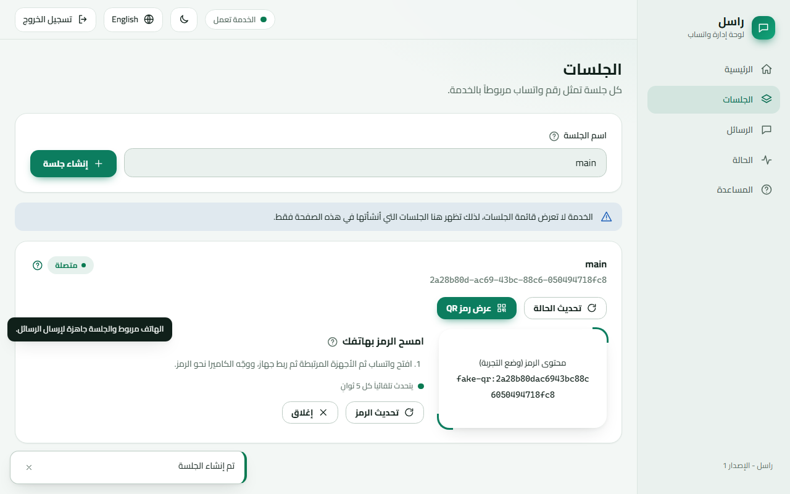
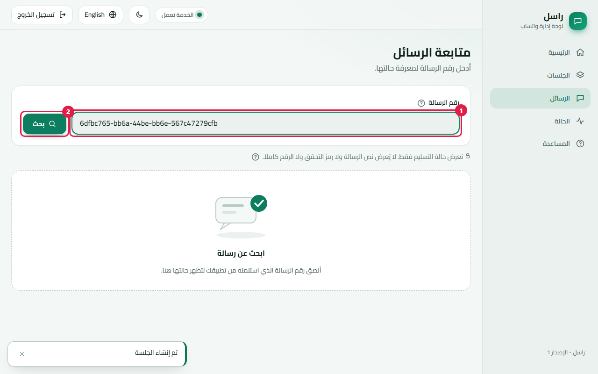
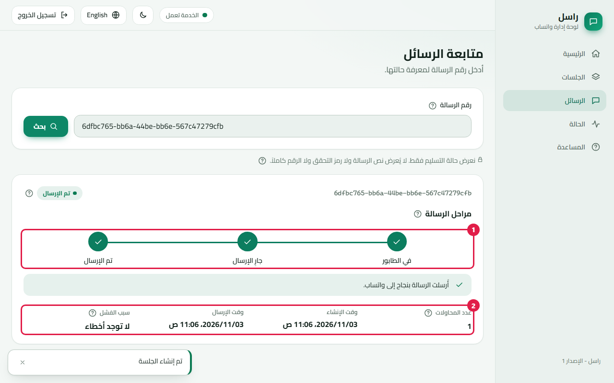

<div dir="rtl">

# دليل استخدام راسل (بالعربية)

دليل خطوة بخطوة لمن يدير راسل يومياً. الأقسام من 1 إلى 5 لا تحتاج أي خبرة برمجية.

> **ما الذي جُرِّب فعلاً؟** كل الصور ومخرجات الأوامر في هذا الدليل أُخذت من **المزوّد التجريبي (Fake)**، وهو محاكي مدمج لا يتصل بواتساب إطلاقاً. ربط هاتف حقيقي (القسم 4) واستلام رمز تحقق حقيقي (القسم 6) **لم يُنفَّذا على واتساب الحقيقي** أثناء كتابة الدليل، وما ورد عنهما يصف طريقة العمل المصمَّمة. وُسمت الخطوات التي ظهرت في صور محاكاة بعبارة **[تجريبي فقط]**. المفاتيح والأرقام والمعرّفات في الصور وهمية أو بدائل.

> بعد الاتصال تعرض صفحة الجلسات رقمك المربوط مخفيًا جزئيًا (مثل +20100****880). اضغط زر العين لإظهاره 30 ثانية ثم يختفي تلقائيًا.
>
> النسخة الإنجليزية: [USER-GUIDE.en.md](USER-GUIDE.en.md)

## 1. ما هو راسل وما وظيفة كل جزء

راسل يتيح لتطبيقاتك إرسال رسائل واتساب (إشعارات ورموز تحقق) عبر رقم هاتف تربطه مرة واحدة. يضع كل رسالة في طابور، ويعيد المحاولة عند الفشل، ويتيح لك معرفة ما حدث لكل رسالة.



| الجزء | وظيفته |
|---|---|
| **تطبيقك** | يطلب من راسل إرسال رسالة أو رمز تحقق. |
| **خدمة راسل** | الخدمة نفسها: تتحقق من المفتاح وتطبّق الحدود وتحفظ الرسائل. |
| **عامل الطابور** | يأخذ الرسائل المنتظرة ويرسلها واحدة واحدة ويعيد المحاولة عند الفشل. |
| **جسر واتساب** | الحلقة التي تربط الخدمة بحساب واتساب الحقيقي (المزوّد). في وضع التجربة يكون المحاكي **Fake**. |
| **لوحة الإدارة** | صفحة الويب الظاهرة في هذا الدليل. |

## 2. تشغيل راسل

**محلياً بدون Docker** (وضع التجربة):

```bash
dotnet run --project src/Rasel.Api            # الخدمة على http://localhost:5114
cd admin && npm install --legacy-peer-deps && npm start   # اللوحة على http://localhost:4200
```

اللوحة عنوانها مختلف عن الخدمة، لذلك يجب أن تسمح الخدمة بها: اضبط `Cors__AllowedOrigins__0=http://localhost:4200` (أو `CORS_ORIGIN` كما في README) قبل التشغيل. في وضع التطوير تطبع الخدمة مفتاحاً عشوائياً مرة واحدة في السجل، ولاختيار مفتاحك اضبط `Seed__DevApiKey`.

**باستخدام Docker** (الخدمة + جسر واتساب):

```bash
cp deploy/.env.example deploy/.env      # املأ الأسرار
docker compose --env-file deploy/.env -f deploy/docker-compose.yml up -d --build
curl http://localhost:8080/health/ready  # يجب أن يرد بحالة ok
```

أبقِ `WHATSAPP_PROVIDER=Fake` حتى تصبح جاهزاً للإرسال الحقيقي.

## 3. تسجيل الدخول بمفتاح الخدمة



1. **عنوان الخدمة**: مكان تشغيل راسل، مثل `http://localhost:5114` (مع Docker: `http://localhost:8080`).
2. **مفتاح الخدمة**: المفتاح الخاص الذي أعطاك إياه مسؤول النظام (الصورة تعرض بديلاً).
3. اضغط **دخول**.

يُحفظ المفتاح في ذاكرة الصفحة فقط. إعادة تحميل الصفحة تُسجّل خروجك، ولا يُحفظ شيء على جهازك. أيقونات **؟** بجانب العناوين تشرح المصطلحات: مرّر الفأرة أو المس أو اضغط Tab للوصول إليها، وEsc للإغلاق.

بعد الدخول تظهر الصفحة الرئيسية:



1. النقطة الخضراء: الخدمة تعمل. 2. القائمة. 3. خطوات عمل راسل الثلاث.

زر الكرة الأرضية يبدّل العربية والإنجليزية، وزر الشمس والقمر يبدّل المظهر الفاتح والداكن.

## 4. ربط رقم واتساب

استخدم **رقماً مخصصاً** لهذا الغرض (القسم 7)، وليس رقمك الشخصي.



1. افتح **الجلسات**. 2. اكتب اسماً (مثل `main`) واضغط **إنشاء جلسة**.



تعرض البطاقة الجديدة **الحالة** (1) وزر **عرض رمز QR** (2).



1. رمز QR، ويتجدد تلقائياً كل 5 ثوانٍ. **[تجريبي فقط]** الصورة تعرض نصاً بديلاً بدل صورة QR حقيقية.
2. على الهاتف: افتح واتساب ثم **الأجهزة المرتبطة** ثم **ربط جهاز**، ووجّه الكاميرا نحو الرمز.



### معنى كل حالة

| الحالة | المعنى | ماذا تفعل |
|---|---|---|
| قيد البدء | الجلسة تُجهَّز. | انتظر ثم اضغط تحديث الحالة. |
| بانتظار QR | جاهزة لكن لم يُربط هاتف. | افتح الرمز وامسحه. |
| متصلة | الهاتف مربوط ويمكنها الإرسال. | لا شيء. |
| فاشلة | تعذّر تشغيل الجلسة. | أنشئ جلسة جديدة أو تواصل مع الدعم. |
| متوقفة | مُطفأة. | لن ترسل حتى يعاد تشغيلها. |

> **لم يُتحقق منه على واتساب الحقيقي.** في المزوّد التجريبي تصبح الجلسة متصلة بمجرد فتح رمزها لأول مرة. مع جسر حقيقي لا تصبح متصلة إلا بعد مسح الرمز.

## 5. إرسال رسالة ومتابعة حالتها

يرسل تطبيقك الرسائل عبر الـ API (اللوحة لا تعرض نص الرسالة ولا ترسله):

```bash
curl -H "X-Api-Key: YOUR-API-KEY" -H "Content-Type: application/json" \
     -H "Idempotency-Key: order-42" \
     -d '{"phone":"+20XXXXXXXXXX","text":"تم شحن طلبك"}' \
     http://localhost:5114/v1/messages
# 202 {"messageId":"<id>","status":"Queued","replayed":false}
```

انسخ `messageId`، وافتح **الرسائل**، والصقه واضغط **بحث**.





1. **مراحل الرسالة**: في الطابور ثم جارٍ الإرسال ثم تم الإرسال (أو لم تصل). 2. عدد المحاولات والأوقات وسبب الفشل بكلمات بسيطة. الرمز الصغير بجانب السبب للدعم الفني فقط. لا يظهر رقم هاتف كاملاً أبداً، وإن ظهر داخل نص فيُخفى ما عدا آخر رقمين.

## 6. مسار رمز التحقق (OTP) من البداية إلى النهاية

**[لم يُنفَّذ على واتساب الحقيقي؛ الأمثلة مأخوذة من عقد الـ API في README.]**

1. **اطلب** رمزاً لهاتف المستخدم:

```http
POST /v1/otp/request
X-Api-Key: YOUR-API-KEY
{"phone":"+20XXXXXXXXXX","purpose":"login","channel":"whatsapp","language":"ar"}

200 {"challengeId":"c3f1...","expiresInSeconds":300,"resendAfterSeconds":60}
```

الرمز نفسه **لا يُعاد** إلى تطبيقك أبداً؛ يرسله راسل إلى واتساب المستخدم.

2. يقرأ المستخدم الرمز في واتساب ويكتبه في تطبيقك.
3. **تحقّق**:

```http
POST /v1/otp/verify
{"challengeId":"c3f1...","code":"123456"}

200 {"token":"<رمز موقّع>","expiresInSeconds":300}
```

يتحقق خادمك من الرمز الموقّع ثم يُدخل المستخدم.

| الرد | بكلمات بسيطة | ماذا تفعل |
|---|---|---|
| 400 `otp_invalid` | الرمز خاطئ. | اسمح بمحاولة أخرى (5 محاولات ثم يُقفل). |
| 410 `otp_expired` | الرمز قديم (5 دقائق). | اطلب رمزاً جديداً. |
| 410 `otp_superseded` | أُرسل رمز أحدث. | استخدم الأحدث. |
| 409 `otp_already_used` | الرمز استُخدم من قبل. | اطلب رمزاً جديداً. |
| **423** `otp_locked` | محاولات خاطئة كثيرة فأُقفلت هذه المحاولة. | انتظر واطلب رمزاً جديداً لاحقاً. |
| **429** `otp_resend_too_soon` | أُرسل رمز للتو، انتظر قبل الطلب مجدداً (60 ثانية). | اعرض عدّاً تنازلياً من `resendAfterSeconds`. |
| **429** `otp_rate_limited` | رموز كثيرة لهذا الرقم أو التطبيق. | خفّف الطلبات وحاول لاحقاً. |
| 502 `otp_delivery_failed` | تعذّر تسليم الرمز عبر واتساب. | تأكد أن الجلسة متصلة ثم أعد المحاولة. |

## 7. حماية الرقم من الحظر

قد يحظر واتساب الأرقام التي تتصرف كرسائل مزعجة. راسل يقلل الخطر لكنه لا يلغيه.

* **التباعد (Pacing)**: فاصل قصير بين الرسائل الجماعية (افتراضياً 1.5 ثانية) ليبدو الإرسال طبيعياً. رموز التحقق لا تتأخر.
* **الحد اليومي**: افتراضياً 5 رسائل كحد أقصى لكل رقم مستلم في اليوم (`429 recipient_daily_limit`).
* **رقم مخصص**: لا تربط رقماً شخصياً أو رقماً لا تحتمل خسارته.
* **رموز تحقق للإنتاج**: استخدم **WhatsApp Cloud API** الرسمي وضع CAPTCHA قبل خطوة طلب الرمز.
* أرسل فقط لمن يتوقع رسائلك.

## 8. حل المشكلات

| العَرَض | السبب المحتمل | الحل |
|---|---|---|
| تسجيل الدخول يقول إن المفتاح غير صحيح | مفتاح خاطئ أو منتهٍ | اطلب المفتاح الصحيح من المسؤول. |
| تعذّر الوصول للخدمة عند الدخول | عنوان خاطئ أو الخدمة متوقفة أو لا تسمح بعنوان اللوحة | راجع العنوان، شغّل الخدمة، اضبط CORS. |
| نقطة حمراء / «تعذر الوصول للخدمة» في الشريط العلوي | الخدمة متوقفة | شغّل الخدمة أو أعد تشغيلها. |
| صفحة الحالة تُظهر مشكلة | مشكلة في قاعدة البيانات أو الطابور | أبلغ المسؤول وراجع سجل الخدمة. |
| اختفت الجلسات بعد التحديث | اللوحة لا تحفظ شيئاً في المتصفح | طبيعي؛ الجلسات ما زالت على الخادم. |
| الجلسة تبقى «بانتظار QR» | لم يمسح أحد الرمز | اعرض الرمز وامسحه من الأجهزة المرتبطة. |
| الرسالة تبقى «في الطابور» | لا توجد جلسة متصلة أو ما زالت تنتظر دورها | اربط جلسة وانتظر ثوانٍ. |
| الرسالة «لم تصل» | واتساب رفض أو فُقدت الجلسة | اقرأ السبب، أعد ربط الجلسة، ثم أعد الإرسال. |
| 409 `session_not_connected` عند الإرسال | الجلسة غير مربوطة | اربطها أولاً (القسم 4). |
| 429 عند الإرسال | حد يومي أو طلبات كثيرة | انتظر؛ راجع القسم 7. |

## 9. قاموس المصطلحات (كل ما يظهر في اللوحة)

| المصطلح | معناه |
|---|---|
| الجلسة | رقم واتساب واحد مربوط براسل. |
| شارة الحالة | قيد البدء، بانتظار QR، متصلة، فاشلة، متوقفة (القسم 4). |
| رمز QR | رمز مربع يُمسح بالهاتف لربطه. |
| مفتاح الخدمة (API key) | كلمة سر الخدمة؛ تبقى في الذاكرة فقط. |
| عنوان الخدمة | مكان تشغيل راسل. |
| رقم الرسالة | الرقم الطويل الذي يُعاد عند وضع الرسالة في الطابور. |
| مراحل الرسالة | في الطابور، جارٍ الإرسال، تم الإرسال / لم تصل. |
| عدد المحاولات | كم مرة حاول راسل الإرسال. |
| سبب الفشل / رمز الخطأ | آخر مشكلة بكلمات بسيطة؛ الرمز للدعم. |
| الرقم المخفي جزئياً | رقم هاتف يظهر منه آخر رقمين فقط. |
| الفحوصات | اختبارات سريعة لقاعدة البيانات وطابور الإرسال. |
| طابور الإرسال (outbox) | صف الرسائل المنتظرة. |
| الحد اليومي | أقصى عدد رسائل لكل مستلم في اليوم. |
| رمز التحقق (OTP) | رمز يُستخدم مرة واحدة لتأكيد الهوية. |
| منع التكرار (idempotency) | مفتاح يمنع إرسال الرسالة نفسها مرتين. |
| التباعد (Pacing) | فاصل بين الرسائل لتفادي الحظر. |

</div>
