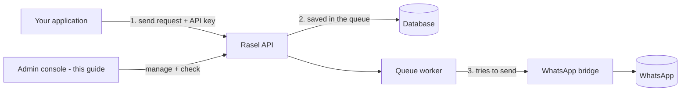
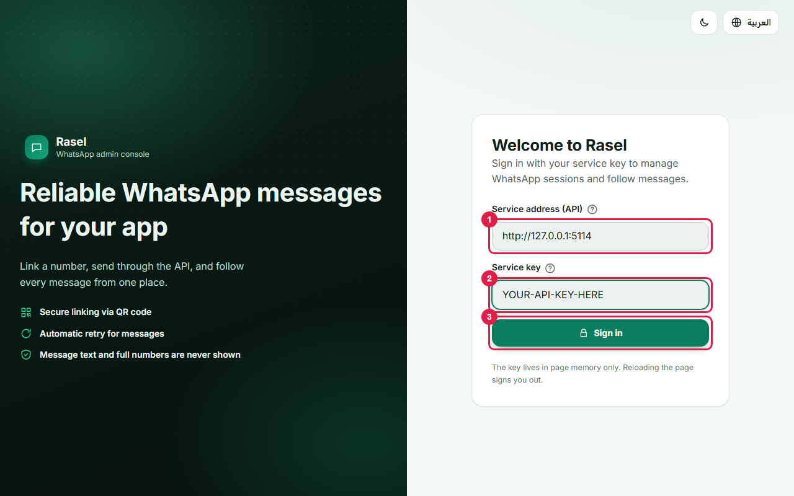
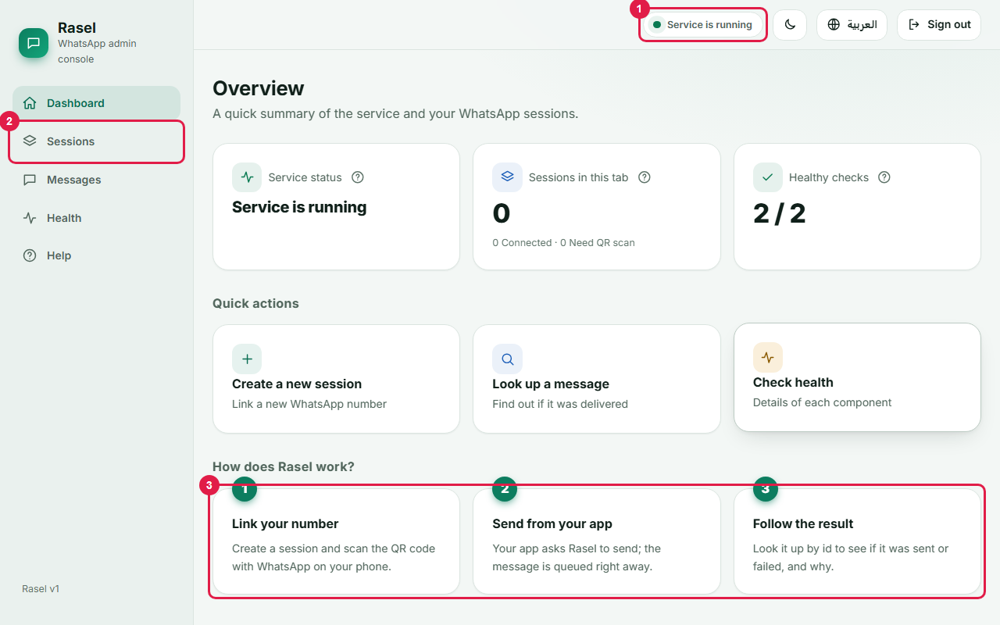
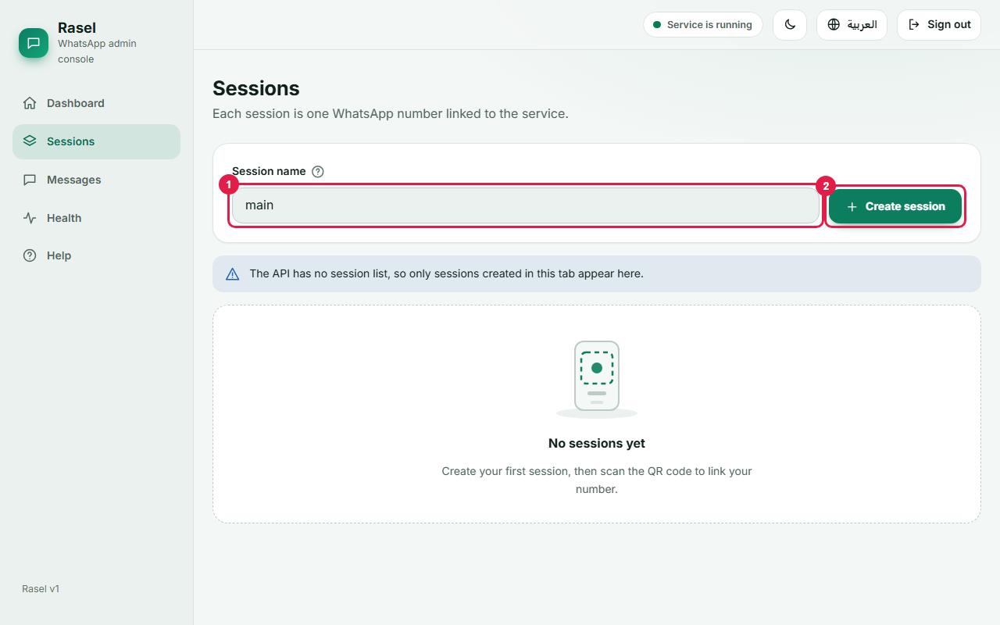
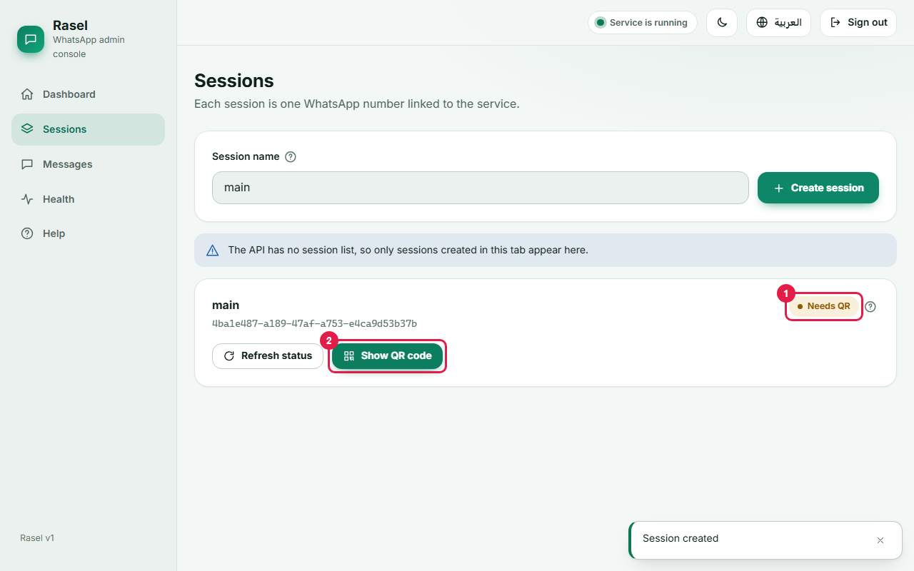
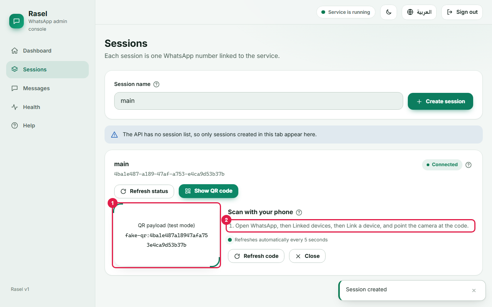
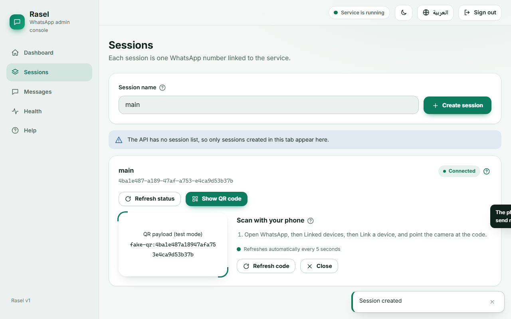
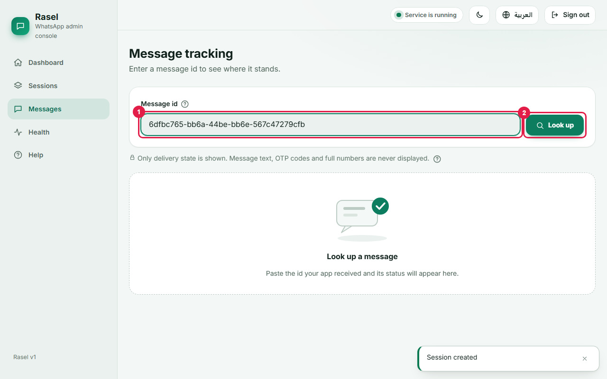
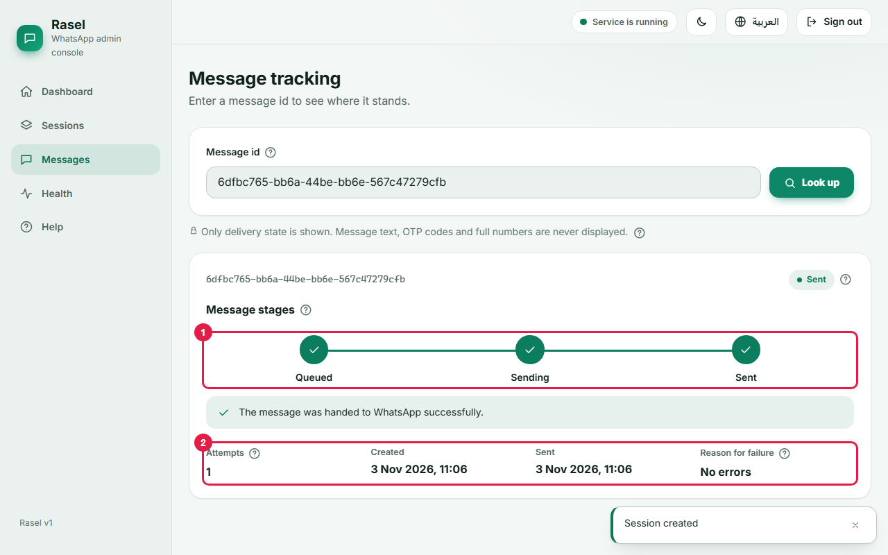

# Rasel User Guide (English)

A step-by-step guide for the person who runs Rasel day to day. No programming knowledge is needed for sections 1 to 5.

> **What was really tested.** Every screenshot and every command output in this guide comes from the **Fake provider**: a built-in simulator that never touches WhatsApp. Linking a real phone (section 4) and receiving a real OTP (section 6) were **not performed on real WhatsApp** while writing this guide; those steps describe how the product is designed to work. Marked with **[Fake only]** where a screenshot is a simulation. Keys, numbers and ids in the pictures are placeholders or fake.
>
> Arabic version: [USER-GUIDE.ar.md](USER-GUIDE.ar.md)

## 1. What Rasel is and what each part does

Rasel lets your own applications send WhatsApp messages (notifications and one-time codes) through a phone number you link once. It queues every message, retries when sending fails, and lets you check what happened to each one.



| Part | What it is for |
|---|---|
| **Your application** | Asks Rasel to send a message or an OTP. |
| **Rasel API** | The service itself. Checks the API key, applies limits, stores messages. |
| **Queue worker** | Takes waiting messages and sends them one by one, retrying on failure. |
| **WhatsApp bridge** | The link to the real WhatsApp account (the "provider"). In test mode it is the **Fake** simulator. |
| **Admin console** | The web page shown in this guide. |

## 2. Starting Rasel

**Locally, without Docker** (test mode, Fake provider):

```bash
dotnet run --project src/Rasel.Api            # API on http://localhost:5114
cd admin && npm install --legacy-peer-deps && npm start   # console on http://localhost:4200
```

The console is a different address from the API, so the API must allow it: set `Cors__AllowedOrigins__0=http://localhost:4200` (or `CORS_ORIGIN` as in the README) before starting. In Development the API prints a random API key once in its log; to choose your own key set `Seed__DevApiKey`.

**With Docker** (API + WhatsApp bridge):

```bash
cp deploy/.env.example deploy/.env      # fill in the secrets
docker compose --env-file deploy/.env -f deploy/docker-compose.yml up -d --build
curl http://localhost:8080/health/ready  # should answer with status ok
```

Keep `WHATSAPP_PROVIDER=Fake` until you are ready for real sending.

## 3. Logging in with the API key



1. **Service address**: where Rasel runs, e.g. `http://localhost:5114` (Docker: `http://localhost:8080`).
2. **Service key**: the private key your administrator gave you. (The picture shows a placeholder.)
3. Press **Sign in**.

The key is kept only in the page memory. Reloading the page signs you out; nothing is saved on your computer. The small **?** icons next to labels explain terms: hover, tap or press Tab to reach them; press Esc to close.

After signing in you see the dashboard:



1. Green dot: the service is running. 2. Menu. 3. The three steps of how Rasel works.

Use the globe button for Arabic/English and the sun/moon button for light/dark.

## 4. Linking a WhatsApp number

Use a **dedicated number** (see section 7), not your personal one.



1. Open **Sessions**. 2. Type a name (e.g. `main`) and press **Create session**.



The new card shows its **state** (1) and a **Show QR code** button (2).



1. The QR code. It refreshes automatically every 5 seconds. **[Fake only]** the picture shows a text placeholder instead of a real QR image.
2. On the phone: open WhatsApp, then **Linked devices**, then **Link a device**, and point the camera at the code.



### What each state means

| State | Meaning | What to do |
|---|---|---|
| Starting | The session is getting ready. | Wait, then press Refresh status. |
| Needs QR | Ready, but no phone linked yet. | Open the QR code and scan it. |
| Connected | Phone linked, can send. | Nothing. |
| Failed | The session could not start. | Create a new session or contact support. |
| Stopped | Switched off. | It will not send until restarted. |

> **Not verified on real WhatsApp.** In the Fake provider a session becomes Connected the first time its QR is opened. With a real bridge it becomes Connected only after you scan the code.

## 5. Sending a message and checking its status

Messages are sent by your application through the API (the console never shows or sends message text):

```bash
curl -H "X-Api-Key: YOUR-API-KEY" -H "Content-Type: application/json" \
     -H "Idempotency-Key: order-42" \
     -d '{"phone":"+20XXXXXXXXXX","text":"Your order has shipped"}' \
     http://localhost:5114/v1/messages
# 202 {"messageId":"<id>","status":"Queued","replayed":false}
```

Copy the `messageId`, open **Messages**, paste it and press **Look up**.





1. The **stages**: Queued, then Sending, then Sent (or Failed). 2. Attempts, times and the reason for a failure in plain words. A small code beside the reason is for support only. Phone numbers never appear in full; if one shows up inside a text it is masked except the last two digits.

## 6. OTP flow end to end (from your application)

**[Not run on real WhatsApp; bodies are from the API contract in the README.]**

1. **Request** a code for a user's phone:

```http
POST /v1/otp/request
X-Api-Key: YOUR-API-KEY
{"phone":"+20XXXXXXXXXX","purpose":"login","channel":"whatsapp","language":"en"}

200 {"challengeId":"c3f1...","expiresInSeconds":300,"resendAfterSeconds":60}
```

The code itself is **never** returned to your app; Rasel sends it to the user's WhatsApp.

2. The user reads the code on WhatsApp and types it into your app.
3. **Verify**:

```http
POST /v1/otp/verify
{"challengeId":"c3f1...","code":"123456"}

200 {"token":"<signed token>","expiresInSeconds":300}
```

Your server checks the token and logs the user in.

| Answer | In human words | What to do |
|---|---|---|
| 400 `otp_invalid` | Wrong code. | Let the user retry (5 tries, then locked). |
| 410 `otp_expired` | The code is too old (5 minutes). | Request a new one. |
| 410 `otp_superseded` | A newer code was sent. | Use the newest code. |
| 409 `otp_already_used` | This code was already used. | Request a new one. |
| **423** `otp_locked` | Too many wrong guesses; this attempt is locked. | Wait and request a new code later. |
| **429** `otp_resend_too_soon` | A code was just sent; wait before asking again (60 s). | Show a countdown using `resendAfterSeconds`. |
| **429** `otp_rate_limited` | Too many codes for this number or app. | Slow down; try again later. |
| 502 `otp_delivery_failed` | WhatsApp could not deliver the code. | Check the session is Connected; retry. |

## 7. Protecting the number from being banned

WhatsApp can block numbers that behave like spam. Rasel lowers the risk; it cannot remove it.

* **Pacing**: a short pause between bulk messages (default 1.5 s) so sending looks natural. OTP messages are not delayed.
* **Daily limit**: at most 5 messages per recipient number per day by default (`429 recipient_daily_limit`).
* **Dedicated number**: never link a personal number or one you cannot afford to lose.
* **Real production OTP**: use the official **WhatsApp Cloud API** and put a CAPTCHA before the "request code" step.
* Send only to people who expect your messages.

## 8. Troubleshooting

| Symptom | Likely cause | Fix |
|---|---|---|
| Sign in says the key is not valid | Wrong or expired key | Ask the administrator for the right key. |
| Sign in says it cannot reach the service | Wrong address, service stopped, or the API does not allow this console origin | Check the address; start the API; set the CORS origin. |
| Red dot / "Cannot reach the service" in the top bar | API is down | Start or restart the API. |
| Health shows a problem | Database or queue problem | Tell the administrator; check the API log. |
| Sessions vanished after reload | The console keeps nothing in the browser | Normal; sessions still exist on the server. |
| Session stays "Needs QR" | Nobody scanned the code | Show QR and scan from Linked devices. |
| Message stays "Queued" | No Connected session, or still waiting its turn | Link a session; wait a few seconds. |
| Message "Failed" | WhatsApp refused or session lost | Check the reason, reconnect the session, send again. |
| 409 `session_not_connected` when sending | The session is not linked | Link it first (section 4). |
| 429 when sending | Daily/recipient limit or too many requests | Wait; see section 7. |

## 9. Glossary (every term in the console)

| Term | Meaning |
|---|---|
| Session | One WhatsApp number linked to Rasel. |
| State badge | Starting, Needs QR, Connected, Failed or Stopped (section 4). |
| QR code | Square code scanned from the phone to link it. |
| Service key / API key | Private password of the service; stays in memory only. |
| Service address | Where Rasel runs. |
| Message id | The long number returned when a message is queued. |
| Stages | Queued, Sending, Sent / Failed. |
| Attempts | How many times Rasel tried to send. |
| Reason for failure / error code | Latest problem in words; the code is for support. |
| Masked number | Phone partly hidden, only the last two digits show. |
| Health checks | Quick tests of the database and the send queue. |
| Send queue (outbox) | Waiting line of messages. |
| Daily limit | Maximum messages per recipient per day. |
| OTP | One-time verification code. |
| Duplicate protection (idempotency) | A key that stops the same message being sent twice. |
| Pacing | Pause between messages to avoid bans. |
